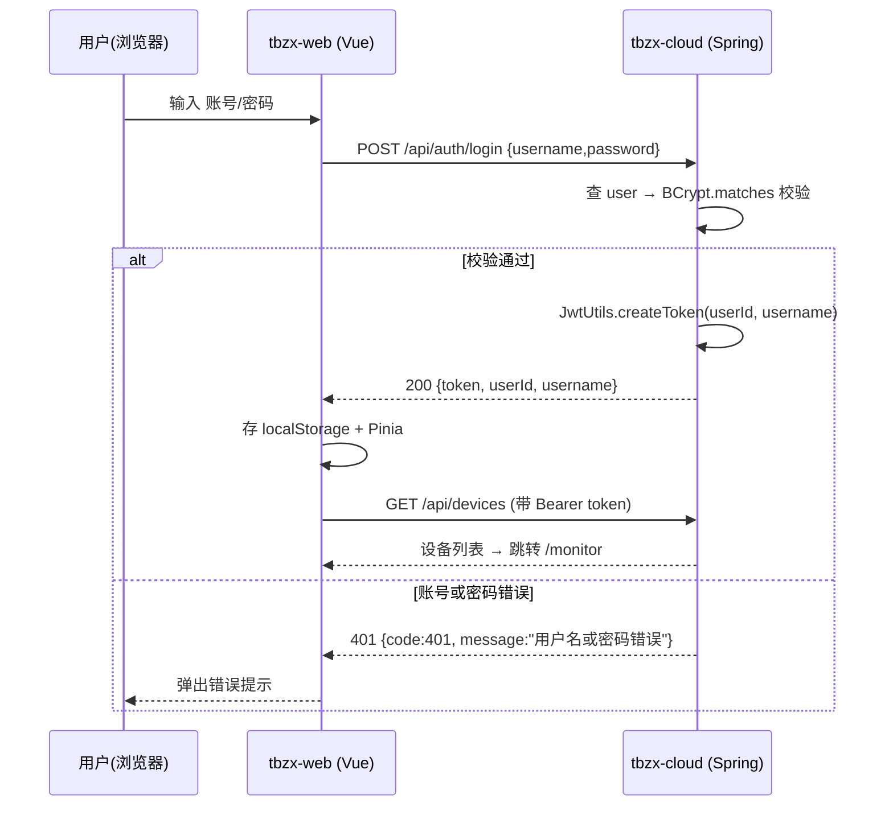
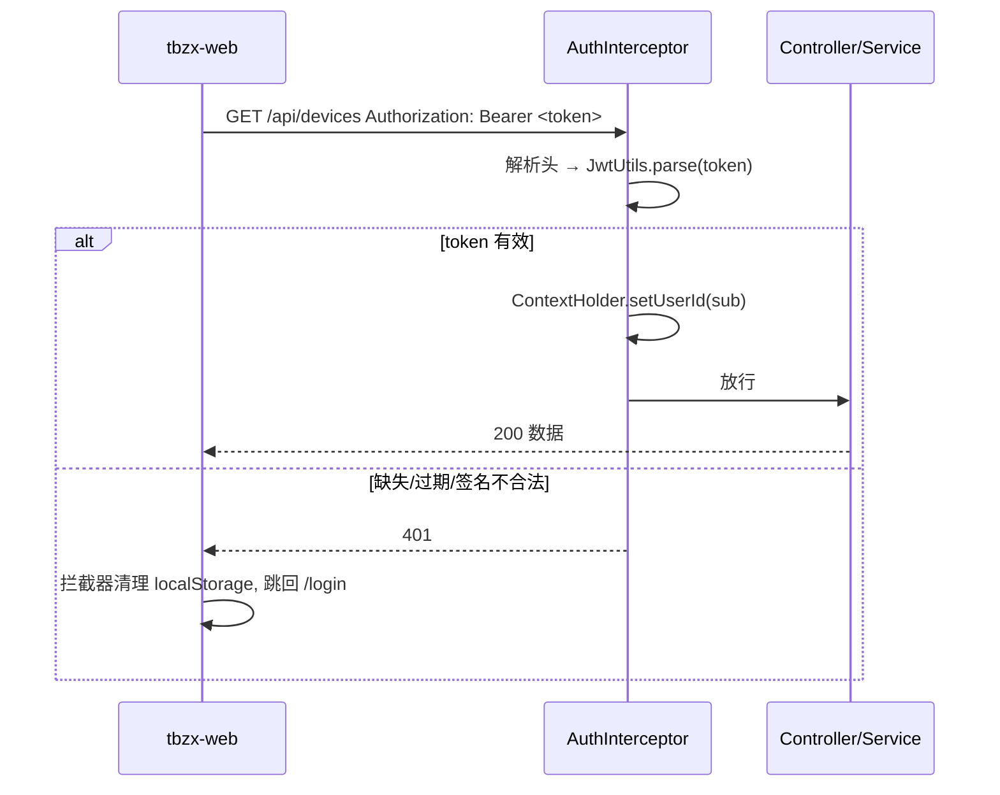
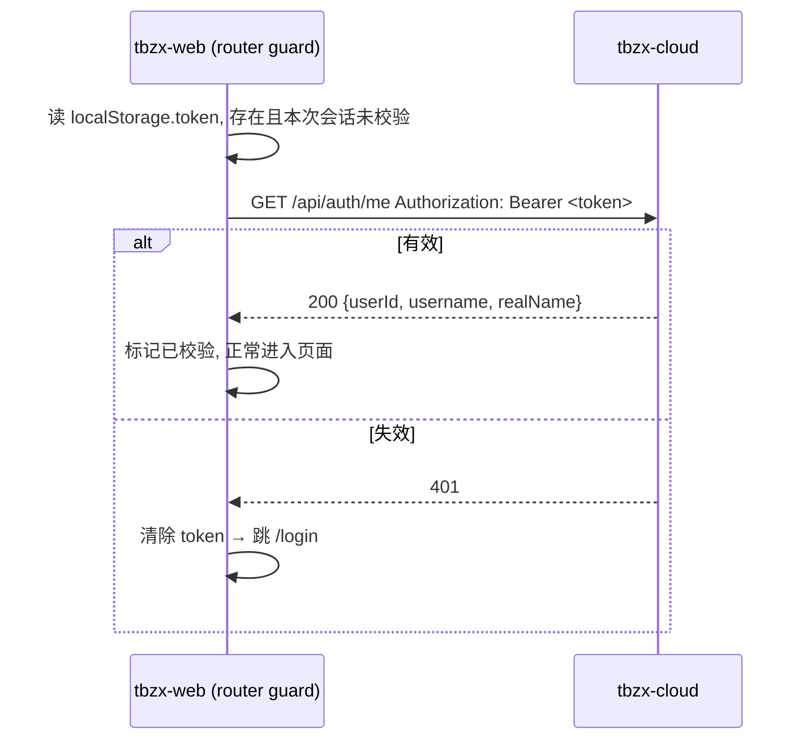
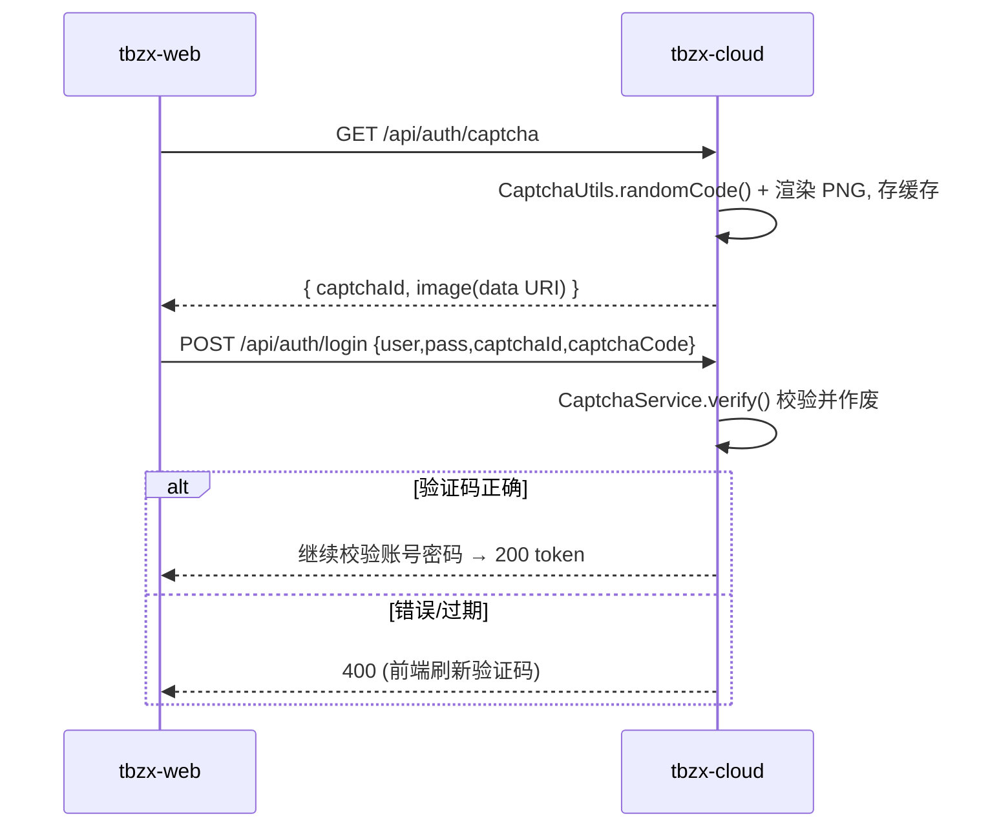

# 登录认证设计（JWT）

> 瞳伴随行 · 家属守护与出行信息服务平台 · 后端 `tbzx-cloud`
> 适用范围：家属端（Web / App）登录鉴权；设备端另有一套 API Key 鉴权，本文一并说明与对比。

---

## 1. 总览：本项目有两套鉴权

| 主体 | 方式 | 凭证 | 载体 | 有效期 |
|---|---|---|---|---|
| **家属端**（人） | JWT（无状态令牌） | 登录后签发的 token | `Authorization: Bearer <token>` | 7 天（`tbzx.jwt-expire-hours`） |
| **设备端**（香橙派） | API Key | 注册时下发一次的明文 key | `X-Api-Key: <key>` | 长期（可吊销） |

家属端是"人"的会话，需要过期、需要防伪造、需要能跨多台机器；设备端是"机"的长期身份，简单、可吊销即可。两者诉求不同，所以用了不同方案（详见 §9 对比）。

本文重点：**家属端 JWT 登录认证**。

---

## 2. 为什么选 JWT

- **前端是前后端分离的 SPA**（Vue3 + Vite），后端是纯 REST API。JWT 天然适配"前端存 token、每次请求带上"的模式，服务端不用维护会话表。
- **无状态、易水平扩展**：后端不存 session，任意实例都能独立校验 token，方便以后多实例部署。
- **可实现跨终端**：Web 与将来的 App 共用同一套 `/api/auth` 与同一份 token 语义。
- **密钥自包含签名**：篡改 payload 会导致签名校验失败，无需查库即可拒绝。

代价与取舍见 §9。

---

## 3. 密码存储：BCrypt

**绝不存明文，也不用 MD5/SHA1。** 本项目用 Spring Security 的 `BCryptPasswordEncoder`。

- 位置：`config/AppConfig.java` 注册 `BCryptPasswordEncoder` Bean。
- 注册：`userService.register()` → `passwordEncoder.encode(rawPassword)` 后入库。
- 登录：`passwordEncoder.matches(rawPassword, storedHash)` 比对。
- **加盐**：BCrypt 每次 encode 会随机生成 salt 并嵌进结果串（`$2a$10$...`），同一密码两次入库的哈希不同，抵御彩虹表。
- **可调代价（cost）**：默认 strength=10，单次哈希约几十毫秒，暴力破解成本高；未来硬件变快可提高 strength 而不破坏旧数据（旧哈希里自带各自代价）。

> 为什么不用 SHA-256 直接哈希？——通用哈希太快，GPU 每秒可算数十亿次，破解成本极低。BCrypt 故意"慢"且自带盐，专为口令设计。

---

## 4. JWT 结构

一个 JWT 是 `header.payload.signature` 三段 Base64URL 拼接：

```
eyJhbGciOiJIUzM4NCJ9 . eyJzdWIiOiIxIiwidXNlcm5hbWUiOiJ0ZXN0IiwiaWF0IjoxNzksImV4cCI6MTc5... . 8B3ZiHLP...
      header                         payload                                        signature
```

- **header**：`{"alg":"HS384"}` —— 使用 HMAC-SHA384 对称签名（`Jwts.builder().signWith(key)` 按密钥长度自动选强算法）。
- **payload（claims）**：本项目签发
  - `sub` = 用户 id
  - `username` = 用户名
  - `iat` = 签发时间
  - `exp` = 过期时间（签发时间 + `jwt-expire-hours` 小时）
- **signature**：用服务端密钥对前两段签名。任何人改动 payload（如把 `sub` 改成别人）都会让签名对不上，`parse()` 直接抛 401。

**⚠️ payload 只做了 Base64URL 编码，不是加密。** 任何人都能解码看到 `username`。因此 **绝不能在 payload 里放密码等敏感信息**；需要保密的放到服务端。

密钥来自 `application.yml`：

```yaml
tbzx:
  jwt-secret: tbzx-dev-secret-key-please-change-in-production-0123456789   # 生产必须换
  jwt-expire-hours: 168   # 7 天
```

> `jwt-secret` 必须 ≥ 32 字符（HS256 要求 256 位密钥），且**生产环境必须更换**，泄露等于任何人都能签发合法 token。

---

## 5. 完整流程

### 5.1 登录签发



### 5.2 携带 token 访问受保护接口



### 5.3 刷新页面 / 启动校验（本次新增）

浏览器刷新后，单页应用内存态丢失，只剩 `localStorage` 里的 token。旧的 token 可能已过期或被删号。



`/api/auth/me` 由 `AuthController.me()` → `UserService.currentUser()` 实现：从 `ContextHolder` 取拦截器写入的 userId，回查用户表，返回公开资料（不含密码）。它同时充当"token 有效性探针"和"获取当前用户"。

### 5.4 图形验证码（登录前置）

登录前先取一张图形验证码，抬高脚本/暴力破解的成本。

- `GET /api/auth/captcha` → `{ captchaId, image }`；`image` 为 PNG 的 data URI，**答案不下发到前端**。
- 答案以 `captchaId → code` 存在服务端 Caffeine 缓存（3 分钟过期），`CaptchaService` 管理。
- 登录 `POST /api/auth/login` 必须带 `captchaId` + `captchaCode`；`verify()` **一次性消费** —— 无论对错立即作废，防重放；失败返回 400。
- 图片由 `CaptchaUtils` 用 `java.awt` 在无头（headless）模式渲染：深蓝底 + 干扰线 + 噪点 + 字符轻微旋转，抗简单 OCR。



### 5.5 注册

`POST /api/auth/register`（开放端点）—— 家属账号注册：

- 入参 `{ username, password, realName }`；后端校验用户名唯一（重复 → 400「用户名已存在」）与长度（用户名 3-50、密码 6-50）。
- 密码经 `BCryptPasswordEncoder.encode()` 加盐哈希后入库；**注册不返回 token**，成功后回登录页重新登录。
- 前端在登录卡片顶部以「登录 / 注册」标签页切换；注册表单含 用户名 / 真实姓名(选填) / 密码 / 确认密码，成功后自动切回登录并预填用户名。

---

## 6. 关键文件清单

| 文件 | 职责 |
|---|---|
| `common/JwtUtils.java` | 签发 / 解析 JWT（HS384，失败抛 401） |
| `common/BizException.java` | 业务异常，`code` 即 HTTP 状态码（401/403…） |
| `common/GlobalExceptionHandler.java` | 统一把异常转成 `{code,message,path,timestamp}` |
| `common/ContextHolder.java` | ThreadLocal 存放本次请求的 userId / deviceId |
| `interceptor/AuthInterceptor.java` | 按"方法+路径"分流鉴权（见 §7） |
| `config/AppConfig.java` | BCryptPasswordEncoder、ApiKey 缓存 Bean |
| `config/WebConfig.java` | 注册拦截器、CORS、静态资源 |
| `common/CaptchaUtils.java` | 图形验证码渲染（java.awt → PNG data URI） |
| `modules/user/controller/AuthController.java` | `/api/auth/register` `/login` `/me` `/captcha` |
| `modules/user/service/UserService.java` | 注册（BCrypt 加密）、登录（验证码+校验+签发）、当前用户 |
| `modules/user/service/CaptchaService.java` | 验证码签发 / 校验（Caffeine 缓存，一次性） |
| `modules/user/dto/*` | `LoginRequest/LoginResponse/RegisterRequest/MeResponse/CaptchaResponse` |

前端：

| 文件 | 职责 |
|---|---|
| `src/api/auth.js` | `login()` / `register()` / `fetchCaptcha()` / `fetchMe()`（按 `VITE_USE_MOCK` 分流） |
| `src/utils/request.js` | axios 实例：请求加 `Bearer`；响应 401 统一踢回登录 |
| `src/stores/user.js` | Pinia 登录态（token/userId/username），同步 localStorage |
| `src/router/index.js` | 路由守卫：无 token 拦截；首跳用 `/me` 校验 token |
| `src/views/Login.vue` | 登录 / 注册页（标签页切换），含图形验证码 |
| `src/components/LoginArtwork.vue` | 生成式蓝色背景（p5），登录 / 注册共用 |

---

## 7. 拦截器分流规则（`AuthInterceptor`）

`/api/**` 全部经过拦截器，按规则放行或校验：

| 请求 | 规则 |
|---|---|
| `OPTIONS`（任意） | 直接放行 —— CORS 预检 |
| `/api/auth/register`、`/api/auth/login`、`POST /api/devices/register` | 开放，无需凭证 |
| `POST` 且路径匹配 `devices/{id}/(heartbeat\|locations\|alerts)`、`alerts/{id}/images` | 设备写 → 校验 `X-Api-Key`（SHA-256 后查缓存） |
| 其余 `/api/**` | 家属 → 校验 `Authorization: Bearer <JWT>` |
| `/images/**` | 不拦截 —— 静态资源直出 |

> 为什么要按"方法"分流：同一个路径 `GET /api/devices/{id}/alerts` 是家属读（JWT），而 `POST` 同路径是设备写（ApiKey），仅凭路径无法区分。

---

## 8. 跨域（CORS）

开发期前端在 `localhost:517x`、后端在 `localhost:808x`，**端口不同即跨域**，浏览器会拦截响应，需要在后端放行。

`application.yml`：

```yaml
tbzx:
  cors:
    allowed-origins: http://localhost:5173,http://localhost:5174,http://localhost:5175
```

`config/WebConfig.java` 的 `addCorsMappings` 读取该配置：

```java
registry.addMapping("/api/**")
        .allowedOrigins(allowedOrigins)
        .allowedMethods("GET","POST","PUT","PATCH","DELETE","OPTIONS")
        .allowedHeaders("*")
        .exposedHeaders("Authorization")
        .maxAge(3600);          // 预检结果缓存 1 小时
```

要点：

- **未开启 `allowCredentials`**：前端用 `Authorization` 头传 token，不依赖 Cookie，因此无需携带凭证。开启它反而会限制 `allowedOrigins` 不能用通配。
- **预检（Preflight）**：带 `Authorization` 或 `application/json` 的跨域请求，浏览器会先发 `OPTIONS`。`AuthInterceptor` 对 `OPTIONS` 直接放行，由 CORS 配置答复，避免预检被 401 拦掉。
- **生产**：改为真实域名，并在 nginx 反代同源部署后，CORS 甚至可以关闭（同源无跨域）。`allowed-origins` 已做成配置项，改 YAML 即可。
- **切勿用 `*` 通配到生产**：等价于允许任意站点调用你的接口。

---

## 9. 与其他认证方式的横向对比

| 维度 | **JWT（本项目家属端）** | Session + Cookie | OAuth2 / OIDC | API Key（本项目设备端） |
|---|---|---|---|---|
| 状态 | 无状态（服务端不存） | 有状态（服务端/Redis 存 session） | 依赖授权服务器 | 无状态（查库/缓存） |
| 凭证载体 | `Authorization: Bearer` | `Set-Cookie`（浏览器自动带） | `Authorization: Bearer`（access/refresh） | 自定义头 `X-Api-Key` |
| 谁签发 | 自己的登录接口 | 自己的登录接口 | 第三方/自建授权服务器 | 系统下发 |
| 过期控制 | token 自带 `exp`；**注销难**（无状态，需黑名单） | 服务端删 session 即失效，注销简单 | access token 短寿命 + refresh 刷新 | 手动吊销记录 |
| 跨域 | 需配 CORS（本项目已配） | 需处理 SameSite/CSRF | 需配 | 需配 |
| 防 CSRF | 天然免疫（token 需 JS 主动加，非浏览器自动携带） | **需额外防护**（Cookie 自动携带） | 天然免疫 | 天然免疫 |
| 水平扩展 | 好（无共享状态） | 差（需共享 session 存储） | 好 | 好 |
| 典型场景 | SPA / 移动端 / 微服务间 | 传统服务端渲染、单体贴 | 第三方登录、单点登录 SSO | 机器/服务调用、开放 API |
| 本项目是否采用 | ✅ 家属端 | ❌ | ❌（可选未来扩展） | ✅ 设备端 |

**为什么家属端用 JWT 而不是 Session+Cookie？**

- 前后端分离 + SPA：token 放 `localStorage`、请求头携带，比 Cookie 更契合；也天然规避 CSRF。
- 无状态便于扩展与多端（Web/App）复用。
- 代价：注销不便（无状态）、token 泄露后直至过期前都有效 —— 通过**较短有效期 + 需要时引入刷新令牌/黑名单**缓解。

**为什么设备端用 API Key 而不是 JWT？**

- 设备是长期在线、无人交互的机器，不需要"登录"和"会话过期"，只需要一个稳定、可吊销的身份。
- key 明文只在注册时返回一次，库里存 SHA-256 摘要（`ApiKeyUtils.sha256Hex`），即使库泄露也无法反推明文。
- 用 Caffeine 缓存"摘要→deviceId"，避免每次上报都查库。

**OAuth2 / OIDC 何时该上？**

- 需求是"用微信/支付宝/学校统一身份登录"，或要做多系统单点登录（SSO）时才引入。
- 本项目是自有账号体系（家长用平台账号登录看护设备），无需第三方授权，OAuth2 属于过度设计；但若将来要接入学校统一身份认证，可在 `AuthController` 旁新增一个 OIDC 回调端点，签发本系统 JWT，前端无感。

---

## 10. 安全清单

- [x] 密码 BCrypt 加盐哈希，不存明文
- [x] JWT 签名校验，篡改即 401
- [x] token 带 `exp`，前端对失效 token 自动登出
- [x] 统一异常 → 标准 HTTP 状态码（401/403/400/500）
- [x] CORS 白名单来源，非通配
- [ ] **生产更换 `jwt-secret`**（当前是开发占位值）
- [ ] **全程 HTTPS**（否则 token 在链路上可被窃听）
- [ ] 敏感操作（改密、解绑）可加二次校验
- [ ] 如需"立即失效"能力：引入 token 黑名单（Redis）或改用短寿命 access token + refresh token

---

## 11. 接口速查

```http
### 注册
POST /api/auth/register
{ "username": "alice", "password": "secret123", "realName": "张三" }
→ 200 { "userId": 3, "username": "alice" }

### 图形验证码
GET /api/auth/captcha
→ 200 { "captchaId": "e02f7e37-...", "image": "data:image/png;base64,..." }

### 登录 (需带验证码)
POST /api/auth/login
{ "username": "test", "password": "123456", "captchaId": "e02f7e37-...", "captchaCode": "3LSM" }
→ 200 { "token": "eyJ...", "userId": 1, "username": "test" }
→ 400 验证码错误 / 已过期

### 当前用户（校验 token）
GET /api/auth/me
Authorization: Bearer eyJ...
→ 200 { "userId": 1, "username": "test", "realName": "测试用户" }
→ 401 未登录/token 失效
```

演示账号：`test` / `123456`（`tbzx.init-demo-data=true` 时启动自动写入）。
